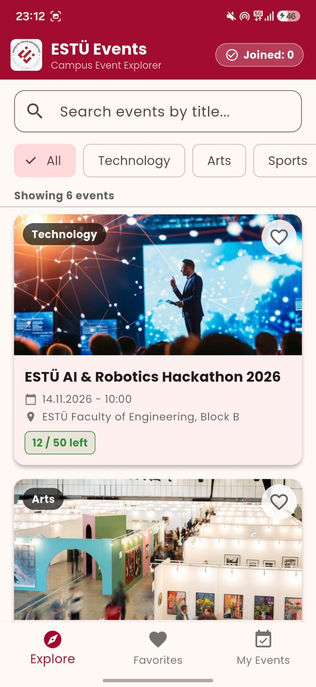
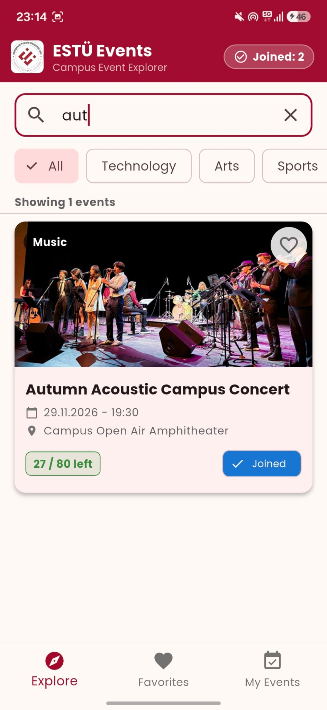
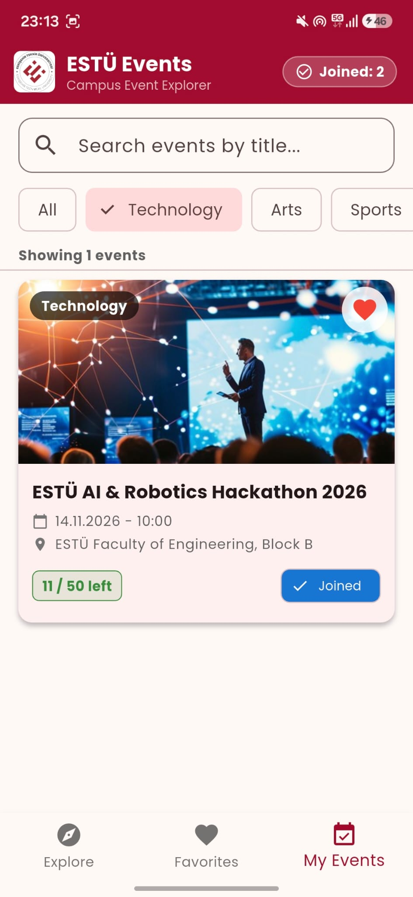
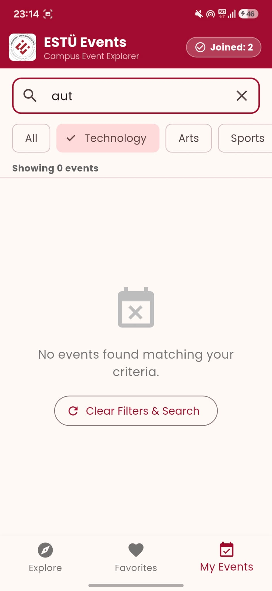
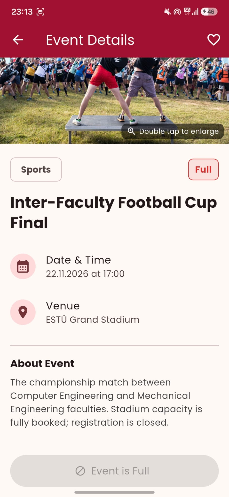
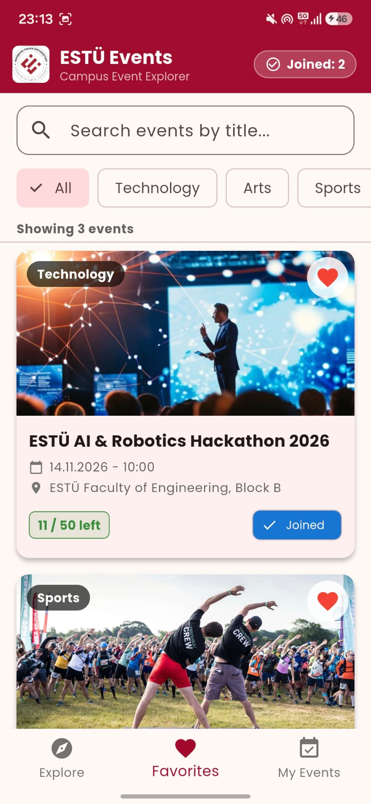
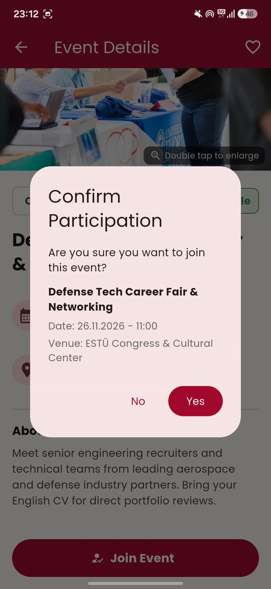
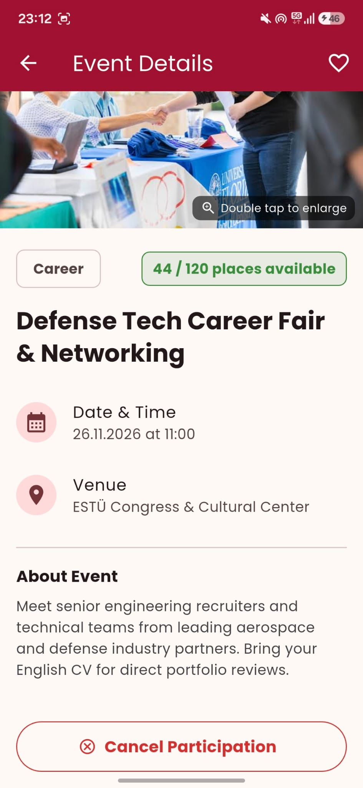
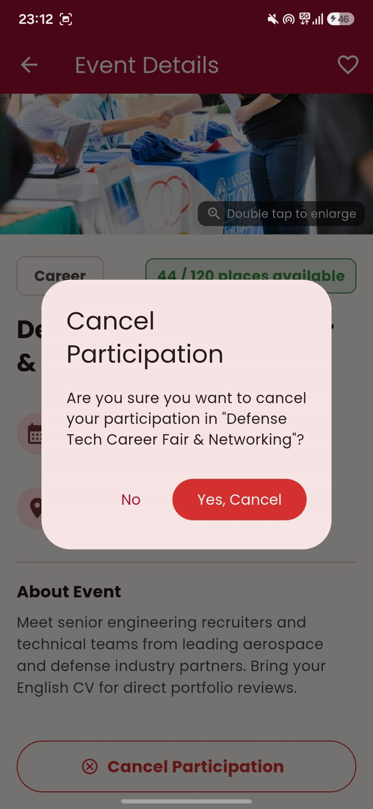

# Campus Event Explorer - ESTÜ Edition

A modern, responsive campus event discovery and management mobile application built with **Flutter** and **Material 3**, themed around the corporate identity of **Eskişehir Technical University (ESTÜ)**.

---

## Overview

**Campus Event Explorer** provides students with an intuitive mobile platform to discover, filter, and join campus events in real time. Designed with a clean Material 3 architecture, the application delivers smooth navigation, local state handling, and interactive details such as event quota tracking and gesture-based image inspection.

---

## Tech Stack & Architecture

- **Framework:** Flutter 3.47.6 (Channel stable)
- **Language:** Dart
- **Design System:** Material 3 (`useMaterial3: true`)
- **Typography:** Custom bundled local font family (**Poppins**)
- **State Management:** Reactive local state management via Flutter's built-in `StatefulWidget` and explicit callback architecture
- **Branding:** Official Eskişehir Technical University color palette (`#A3082C`)

---

## Key Features

- **Event Discovery & Instant Filtering:** Multi-category filtering (`Technology`, `Arts`, `Sports`, `Career`, `Music`) paired with real-time text search.
- **Dynamic Participation Workflow:** Join and cancel actions with confirmation dialogs, live quota increment/decrement, and full-capacity protection.
- **Interactive Media Viewer:** Full-screen event poster viewer equipped with double-tap gesture zooming.
- **Bookmarks / Favorites:** Dedicated favorites management tab to track saved campus activities.
- **Zero External UI Dependencies:** Built strictly using Flutter core widgets and custom styling.

---

## State Management Approach

- The application uses Flutter's native **`StatefulWidget`** and **`setState()`** pattern for lightweight, responsive, and predictable in-memory state tracking.
- Interactive states (such as active category filters, joined events, remaining quotas, and bookmarked cards) are maintained locally and propagated across the widget tree via explicit constructor callbacks (`onFavoriteToggle`, pop result handlers).

---

## UI Showcase & Application Flow

### 1. Discovery, Search & Filtering
| Explore Screen | Active Search Match | Category Filter (Technology) | Empty State (No Matches) |
| :---: | :---: | :---: | :---: |
|  |  |  |  |

### 2. Event Details & Image Zoom
| Event Details View | Enlarged Image (Double-Tap) | Full Capacity State (Disabled) | Favorites Tab |
| :---: | :---: | :---: | :---: |
|  |  |  |  |

### 3. Participation Management & State Updates
| Join Confirmation Dialog | Joined State (Cancel Available) | Cancel Dialog | Cancellation Feedback |
| :---: | :---: | :---: | :---: |
|  |  |  |  |

---

## Project Structure

```text
lib/
├── data/           # Mock event data sources
├── models/         # Event data classes
├── screens/        # Primary application screens (Explore, Details, Favorites, Image Viewer)
├── widgets/        # Reusable UI components (EventCard, CategoryChips, Dialogs)
└── main.dart       # App entry point & theme definitions

```
---

## Getting Started

### Prerequisites
- Flutter SDK (3.47.6 or newer)
- Android Studio / VS Code with Flutter & Dart extensions
- Connected Android device or emulator

### Installation & Run
1. Clone the repository:
   ```bash
   git clone [https://github.com/fatmamuge/campus-event-explorer.git](https://github.com/fatmamuge/campus-event-explorer.git)
   cd campus-event-explorer

```
2. Install dependencies:
   ```bash
   flutter pub get
   ```
3. Run the application:
   ```bash
   flutter run
   ```

---

## Credits & License

- **Developer:** Fatma Müge Sıtkı
- **Typography:** [Poppins](https://fonts.google.com/specimen/Poppins) (SIL Open Font License)
- **Imagery:** Creative Commons & Unsplash campus/technology photography
- **Identity:** Eskişehir Technical University Corporate Identity
